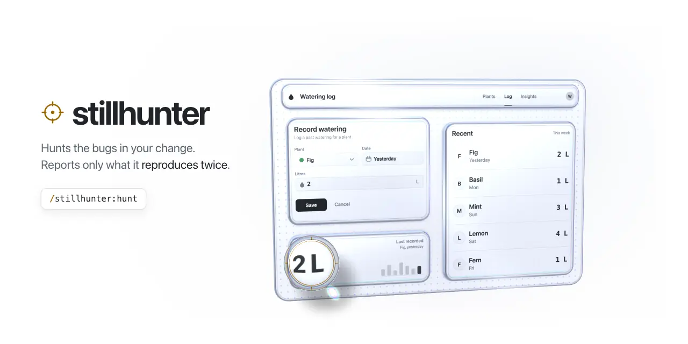

# Stillhunter

<p align="center">
  <picture>
    <source media="(prefers-color-scheme: dark)" srcset="https://raw.githubusercontent.com/stillhunter/stillhunter/v0.2.5/docs/media/hero-dark.webp">
    <source media="(prefers-color-scheme: light)" srcset="https://raw.githubusercontent.com/stillhunter/stillhunter/v0.2.5/docs/media/hero-light.webp">
    
  </picture>
</p>

**Find the bugs in your change before your users do.** Stillhunter is a Claude Code plugin that tests your web app change in a real browser, the way a careful QA engineer would. It reports only bugs it has seen happen twice, and you can keep each one as a test.

## Install

Inside Claude Code:

```
/plugin marketplace add stillhunter/stillhunter
/plugin install stillhunter@stillhunter
```

You also need Node.js 22.22 or later and Chrome, Edge or Chromium.

**For a team, in one repository.** Install it at project scope instead, so it is on for everyone who works in the repository and nowhere else:

```sh
claude plugin marketplace add stillhunter/stillhunter
claude plugin install stillhunter@stillhunter --scope project
```

That records it in `.claude/settings.json`. Add the marketplace there too and commit the file, so a teammate's Claude Code knows where the plugin comes from. With `autoUpdate` off, a new version arrives only when you update the marketplace yourself, so each one can be reviewed first:

```json
{
  "extraKnownMarketplaces": {
    "stillhunter": { "source": { "source": "github", "repo": "stillhunter/stillhunter" }, "autoUpdate": false }
  },
  "enabledPlugins": { "stillhunter@stillhunter": true }
}
```

Each teammate then runs `claude plugin install stillhunter@stillhunter --scope project` once in their clone. See Claude Code's [plugin install scopes](https://code.claude.com/docs/en/plugins/install).

## Use

1. **Start your app** on your machine, as you do when you work on it.
2. **Tell Stillhunter where it runs** (skip this for a Nuxt, Vite or Next dev server on its usual port; it is found for you). Create `.stillhunter/config.json`:

   ```json
   { "target": { "url": "http://localhost:3000" } }
   ```

   Or name it in the hunt: `/stillhunter:hunt the invite dialog at http://localhost:8080`.

3. **Hunt.** Make your change on a branch, then run:

   ```
   /stillhunter:hunt
   ```

   You can also name what to look at: `/stillhunter:hunt the invite dialog`. About 10 minutes later you get a list of confirmed bugs, each with a script that shows it.

4. **Keep a bug as a test**, so you know when it is fixed:

   ```
   /stillhunter:keep 1
   /stillhunter:replay
   ```

Does your app need a sign-in? Set the test account in your shell before you start Claude Code, for example `APP_EMAIL` and `APP_PASSWORD`. To pass exactly the variables you choose, and nothing else, list them in the config: `"signIn": { "variables": ["APP_EMAIL", "APP_PASSWORD"] }`.

Does your dev frontend call a staging API, or sign in through a hosted login page? Probes reach only your machine unless you list more hosts in the config, for every probe or for the sign-in only. Does your app keep data in a real database? A `reset` command puts it back before each probe, or only before each re-run. The [guide](https://github.com/stillhunter/stillhunter/blob/main/docs/guide.md#configuration) covers both, with recipes such as a Postgres snapshot restore.

Use a local app with test data only: Stillhunter runs code the model writes against it.

## Check the package

Claude Code installs Stillhunter from npm, at the exact version the marketplace names. To check that the package is what this repository builds, build it from the tag and compare the two, file by file (here for 0.2.5):

```sh
git clone --depth 1 --branch v0.2.5 https://github.com/stillhunter/stillhunter
(cd stillhunter && npm ci && npm run build && node scripts/pack.mjs ../built)
npm pack stillhunter@0.2.5 --pack-destination published
mkdir -p from-source from-npm
tar -xzf built/stillhunter-0.2.5.tgz -C from-source
tar -xzf published/stillhunter-0.2.5.tgz -C from-npm
diff -r from-source/package from-npm/package && echo "same files"
```

The package's only runtime dependency is `playwright-core`, pinned to an exact version in its `npm-shrinkwrap.json`. Releases are published from the [release workflow](.github/workflows/release.yml) through npm trusted publishing, with no long-lived token. Where npmjs.com shows a provenance statement for a version, npm has checked that it was built by that workflow from the tagged commit; `npm audit signatures` checks the signatures and provenance of an installed copy.

## Learn more

- [Guide](https://github.com/stillhunter/stillhunter/blob/main/docs/guide.md): all commands and settings, how a hunt works, and how probes are contained
- [Benchmark](https://github.com/stillhunter/stillhunter/blob/main/benchmark/comparison/REPORT-three-arm-0.2.md): on six held-out planted bugs, three runs each, Stillhunter found the bug in 18 of 18 runs with 0.26 false alarms per run. An independent verifier confirmed 95% of its findings, and 17 of its 18 kept tests were valid. Claude Code with Playwright found 16 of 18 with about 3 false alarms per run and 47% of its findings confirmed, even when told to verify each one. Stillhunter took about three times as long and cost about 2.5 times as much per run. The recall gap is not significant; the false-alarm gap is. The [guide](https://github.com/stillhunter/stillhunter/blob/main/docs/guide.md#where-it-stands) has the full table and the earlier results.
- [Changelog](https://github.com/stillhunter/stillhunter/blob/main/CHANGELOG.md) · [Security](https://github.com/stillhunter/stillhunter/blob/main/SECURITY.md) · MIT licence
